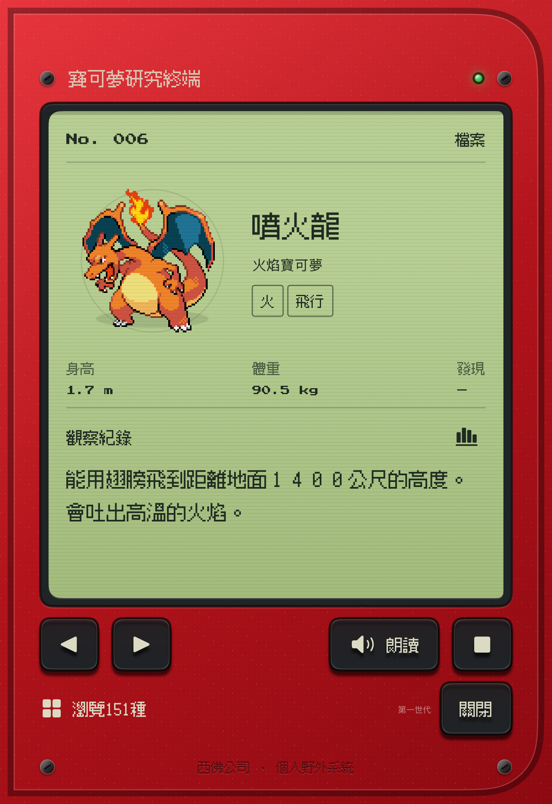

[English](README.md) | [简体中文](README.zh-CN.md) | [繁體中文](README.zh-TW.md) | [日本語](README.ja.md)


# iDex

為 iPhone Duo 打造的口袋寶可夢圖鑑。對準、掃描，假裝大木博士已經核准了你的研究經費。

原生 SwiftUI · English / 简体中文 / 繁體中文 / 日本語 · 裝置端 Core ML

## 出門考察一下

| 掃一掃 | 英文圖鑑 | 繁體中文 | 日本語 |
| :---: | :---: | :---: | :---: |
|  |  |  |  |

以上皆為 iPhone Duo 模擬器的真實截圖。皮卡丘是明確標示的模擬器範例，使用內建模型進行辨識。拍攝期間，沒有野生寶可夢受到打擾。

[掃描之前](docs/screenshots/scanner-sample-en.png) · [搜尋圖鑑](docs/screenshots/catalog-search-en.png)

## 背包裡有什麼？

- **關都地區的151種寶可夢。** 像素圖、基礎能力、觀察紀錄，還有叫聲。
- **拍照掃描，也能匯入照片。** 辨識在 iPhone 上完成，照片只保留在記憶體中。
- **展開螢幕，研究空間更大。** 內側螢幕會在掃描器旁顯示圖鑑面板。
- **English、简体中文、繁體中文和日本語。** 全151種寶可夢都有在地化名稱、描述、屬性和能力標籤。可依名稱、編號或屬性搜尋，並用已安裝的系統語音朗讀。
- **本機發現紀錄。** 關閉 App 後，進度依然保留。研究經費依然只是想像。

## 選擇語言

開啟**設定 → 語言**，選擇 **English**、**简体中文**、**繁體中文**或 **日本語**。第一次啟動時會採用系統偏好中支援的語言（`zh-TW`、`zh-HK` 與 `zh-Hant` 會對應到繁體中文），之後會記住你的選擇。介面、輔助使用標籤、圖鑑內容和朗讀都會跟著所選語言切換。名稱可以跨四種語言搜尋，屬性搜尋則使用目前的語言。朗讀使用 iOS 上已安裝的語音（繁體中文使用 `zh-TW`）。

## 開始使用

需要 **Xcode 27.1** 和 **iOS 27 或更新版本**。鉸鏈狀態偵測使用 iOS 27.1 API。

```sh
open iDex.xcodeproj
```

選擇 **iDex → iPhone Duo**，然後執行。不需要設定第三方套件、API 金鑰、伺服器或執行階段下載。在模擬器中，點一下**掃描**就能辨識皮卡丘範例。在實機上，請允許相機存取，或匯入一張照片。

執行測試：

```sh
xcodebuild test -project iDex.xcodeproj -scheme iDex \
  -destination 'platform=iOS Simulator,name=iPhone Duo'
```

## 有大木博士那麼準嗎？

大木博士暫未回應。模型認得最初的151種寶可夢，但還是可能把無關的物體誤認成寶可夢。分數不是經過校準的機率；信心度偏低的結果不會自動列入發現紀錄，也不會自動朗讀。真實相機的辨識準確度與實體鉸鏈行為仍需要實機驗證。

## 打開外殼看看

SwiftUI、AVFoundation、Core ML 和系統語音。所有處理都在本機完成。

以下技術文件為英文：

[開發指南](docs/development.md) · [模型說明](iDex/Recognition/MODEL.md) · [效能](docs/performance.md) · [截圖與圖像資源](docs/images/README.md)

## 授權

iDex 的原創 App 原始碼及配套腳本採用 [MIT 授權](LICENSE)，版權所有 (c) 2026 Zihang Huang。適用範圍和排除項目請見 [NOTICE.md](NOTICE.md)。

打包的模型不適用 MIT；貢獻者對訓練模型所持有的權利，依[模型聲明](iDex/Recognition/MODEL_NOTICE.md)中的範圍以 CC BY-NC-SA 4.0 提供。寶可夢內容和外部訓練資料集也不適用 MIT。另見[素材標示](iDex/Catalog/ATTRIBUTION.md)；內建字型保留 [Press Start 2P](iDex/Resources/Fonts/PressStart2P-OFL.txt) 和 [Fusion Pixel](iDex/Resources/Fonts/FusionPixel-OFL.txt) 的 OFL 授權。

## 感謝各位人類

像素圖：[Pokémon Database](https://pokemondb.net/sprites)。資料與叫聲：[PokéAPI](https://github.com/PokeAPI/pokeapi)。模型：使用 [TorchVision](https://docs.pytorch.org/vision/stable/models/efficientnet.html) 在本機訓練的 EfficientNet-B0（FP32）。字型：Press Start 2P 和 Fusion Pixel（SIL OFL 1.1）。

[完整素材標示](iDex/Catalog/ATTRIBUTION.md) · [模型來源](iDex/Recognition/MODEL.md)

本專案是非官方的粉絲作品。寶可夢及相關權利歸任天堂、Creatures、GAME FREAK 和 The Pokémon Company 所有。iDex 與這些公司沒有關聯，也未獲得其認可。
